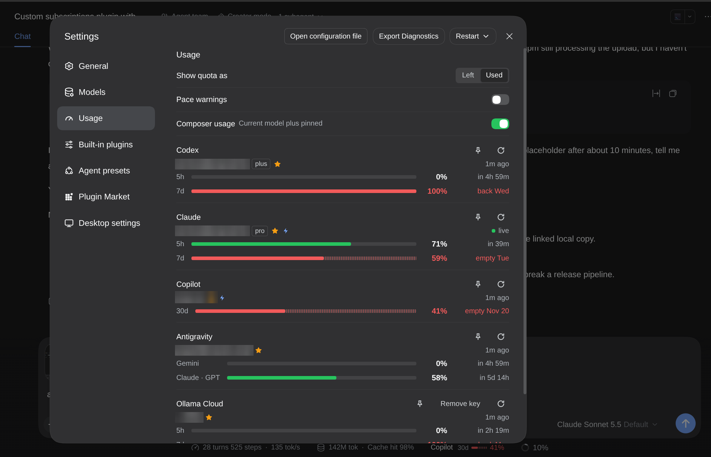
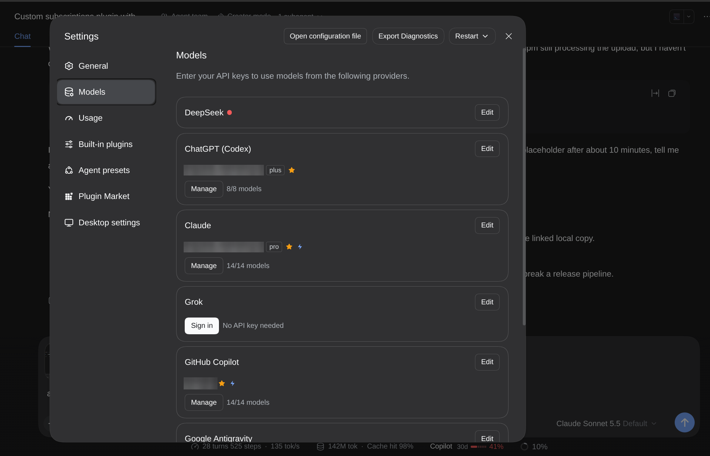
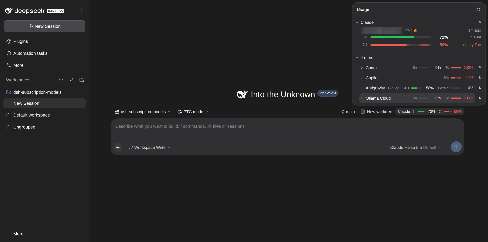
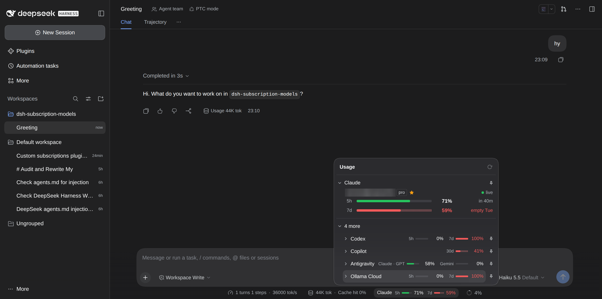

# dsh-plugin-subscription-usage

A DeepSeek Harness plugin that uses your ChatGPT (Codex), Claude, Grok, GitHub Copilot and Google Antigravity subscriptions as LLM providers, and shows how fast you are using each limit.

## What you get

- **Models page.** Each subscription is a provider row where you sign in, manage accounts, choose models and enable tools.
- **Usage page.** Settings, Usage shows each limit with a pace forecast: how much is used, when it resets, and whether you will run out first. You can switch between Left and Used, turn pace warnings on or off, and pin providers to the composer.
- **Composer gauge.** The current model's provider, plus any you pinned, shows under the composer.
- **API key usage.** Z.ai, Ollama Cloud and Kimi Code usage is read with an API key you paste on the Usage page. These providers are usage-only. The plugin does not route requests to them.

## Screenshots

Usage page in Settings, with pace forecasts and pins:



Models page, where each subscription is a provider row:



Usage pop-up in the composer on a new session:



The same pop-up inside a chat:



## Install

```bash
dsh plugin install dsh-plugin-subscription-usage
```

Restart DSH, then open Settings, Models.

## Privacy

- OAuth sessions are stored in `~/.dsh/plugins/subscriptions/auth.json`.
- API keys are stored in `~/.dsh/plugins/subscriptions/usage-keys.json`.
- Both files are readable only by you. Keys are sent only to the provider's own host and never to the browser page, which sees the last four characters.

## Limits

- Copilot, Z.ai, Ollama Cloud and Kimi Code usage comes from endpoints the vendors do not document. They can change without notice, and the card then shows "Usage unavailable".
- A plain Moonshot key does not work for Kimi Code usage.

## License

MIT
