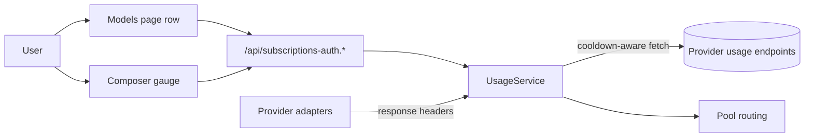
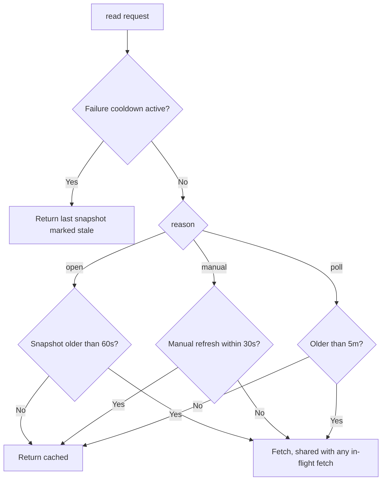

# Subscription providers in Models, with pace-aware usage

> Signed-in ChatGPT (Codex), Claude, Grok, GitHub Copilot and Google Antigravity subscriptions appear as rows on the DSH Models settings page, and their limits show as pace-aware meters in Settings and under the composer.

## 1. Feature Snapshot

| Field | Details |
|---|---|
| Document status | Active |
| Implementation status | Shipped, GUI check for AC-014 pending |
| Owner | Parth Patel |
| Primary actors | DSH Web user with one or more subscription accounts |
| Trigger | Opening Settings, Models; sending a prompt; opening the composer usage gauge |
| Outcome | One place to sign in, manage accounts and models, and see how fast each limit is being used |
| Entry points | `settings.models.provider-card`, `settings.models.footer`, `conversation.composer.dock`, `conversation.hero.options`, `shell.overlay` |
| Data stores | `~/.dsh/plugins/subscriptions/*.json` (existing upstream files), plugin Config volatile fields |
| Feature flag | Not applicable |
| Last verified | Unit tests and a browser harness on 2026-11-08; no commit yet |

**Status legend.** **Current** is read in code at `last_verified_commit`. Until the first commit, **Current** means read in the uncommitted working tree on `last_updated`. **Planned** is not implemented. **Inferred** is not directly verified. **Unknown** is unresolved.

UI reference: [design/usage-draft.html](../../design/usage-draft.html), draft v3, approved by the owner on 2026-11-08.

## 2. Problem and Outcome

**Problem.** The upstream plugin `dsh-plugin-subscriptions` 0.9.12 keeps subscriptions on a separate Settings page and shows usage as "% used plus reset date". That answers what was spent, not whether the limit will last until reset. It refreshes every 15 minutes, so the composer pill is often stale.

**Desired outcome.** Each subscription is a Models row. Each limit shows a bar whose color is its pace state, a forecast of when it empties, so the user can see at a glance whether they will run out before reset. Usage updates after every response without extra provider calls.

## 3. Scope

**Included**

- Rename the package to `dsh-plugin-subscription-usage` and keep the upstream core for auth, providers, pools, translation and tools, including Grok and its tools.
- Register each enabled provider as a configurable provider so the Models page lists it.
- Provider card body, Models footer options, composer gauge and popover, new-session gauge, pace notices.
- Live usage from response headers, refresh policy, and a server-side record of the serving account per session.

**Excluded**

- The upstream Subscriptions settings page, usage badge and its preferences. These are removed.
- Hiding the host **Edit** button on our rows. Only DSH can do that, so we will file a request upstream.
- Usage history and trends, the `/usage` command, and a quota tool for the agent. These are follow-ups.

**Assumptions**

| ID | Assumption | Confidence | How it gets validated |
|---|---|---|---|
| ASM-001 | A plugin-registered configurable provider renders as a Models row and receives the `settings.models.provider-card` slot | High | Probe plugin on 2026-11-08: the owner saw the row and the slot text |
| ASM-002 | Codex and Claude streaming replies carry plan usage in response headers | High | Probe on 2026-11-08, output below |
| ASM-003 | `conversation.hero.options` renders before the first prompt while `conversation.composer.dock` does not | Medium | Read in `dsh-client-ui-conversation` 0.2.2-rc.1, `lib/client.js` lines 20549-20553 and 22219. Not yet confirmed in the live GUI |
| ASM-004 | Grok, Copilot and Antigravity replies carry no usable usage headers | Low | Not probed. Those providers keep endpoint polling |

**ASM-002 probe.** A tiny prompt went through the real upstream adapters on 2026-11-08. Only header names and rate-limit values were printed. Codex returned `x-codex-primary-used-percent`, `x-codex-primary-window-minutes: 300`, `x-codex-primary-reset-at`, and the matching `secondary` fields for the 10080-minute window. It sent them on a 429 as well. Claude returned `anthropic-ratelimit-unified-5h-utilization: 0.56`, `-5h-reset`, `-7d-utilization: 0.46` and `-7d-reset`. Claude reports utilization as a 0 to 1 fraction, while Codex reports a 0 to 100 percent.

## 6. User Journey

1. The user opens Settings, Models. Each enabled subscription provider is a row below the host providers.
2. A signed-out row shows **Sign in**. Browser OAuth shows a progress strip with a paste fallback, and Copilot shows the device code.
3. A signed-in row shows the active account in full. Other accounts fold into one summary row.
4. **Manage** opens Accounts, Models and Tools tabs inline.
5. The user sends a prompt. The reply's headers update the meters without a usage call.
6. The composer gauge shows meters for the current model's provider, then any pinned providers. When none of those reports usage, the gauge shows a meter icon instead. Clicking either opens the popover.
7. The popover lists the shown providers expanded. Other signed-in providers with usage sit behind a folded "N more" row, each with a pin button. With nothing shown, the popover lists them all without the fold.
8. The user pins a provider from the popover or from the pin button on its Models card. Composer usage has one on or off switch in the Models footer.

**Alternate paths**

| Journey | Trigger | Expected outcome |
|---|---|---|
| Sign-in expires | Token refresh fails permanently | Row dot turns red and the account shows "Sign-in expired" with **Sign in** |
| Usage endpoint fails | 429 or network error | Last snapshot stays with a stale marker; no retry until the cooldown ends |
| Claude account stored without an email | Older upstream login | Startup fetches the profile with the `oauth-2025-04-20` beta header and saves the email, so the row stops showing `token-…` |
| Limit exhausted | A window reaches 100% | Time column shows "back <time>"; the pool moves to another account and a notice says so |
| New session | Nothing typed yet | Gauge renders in the hero options row |
| Current model has no usage | A Copilot or host model is selected | Gauge shows the meter icon and the popover lists every metered provider |

## 7. System Context

The Host half owns credentials, usage snapshots and preferences. The Client half renders inside host slots and talks to the Host over the existing `/api/subscriptions-auth.*` routes.



`UsageService` wraps the upstream `PoolUsageTracker` and adds header ingestion. Routing and display read the same snapshots.

## 8. Control Flow

Refresh decisions happen in `UsageService.read(provider, account, reason)`.



| Step | Status | Controlling component | Failure behavior |
|---|---|---|---|
| Header ingestion | Current | `src/usage/headers.ts`, called from each adapter's `onResponse` hook, merged by `PoolUsageTracker.ingest` | Unparseable headers are ignored; ingestion is skipped during a failure cooldown |
| Refresh policy | Current | `src/usage/service.ts` | Failure keeps the last snapshot and sets `retryAt` |
| Pace computation | Current | `src/usage/pace.ts`, shared by Host and Client | Missing duration or reset falls back to plain percent |

## 9. Data Flow

Response headers flow from the adapter fetch into `UsageService.observe`, which calls `PoolUsageTracker.ingest`. It merges them into the account's snapshot with `source: 'live'` and `fetchedAt: now`. The Client reads snapshots through `usage`. It polls every 5 minutes while the document is visible and on popover open, and it receives a revision number with each `status` response so it re-reads after a turn ends.

The serving account is recorded per session id when the pool or direct route picks an account. The `status` response returns it so the bolt icon marks the account that actually served the latest request.

**Sensitive data.** OAuth tokens stay in `auth.json` (mode 0600) and never reach the Client or the logs. Usage headers carry no secrets. `x-codex-turn-state` is not stored.

## 11. Implementation Map

### Existing

Copied from upstream commit `dad6ff1` without changes. See `UPSTREAM`.

| Layer | Responsibility | Repository path |
|---|---|---|
| Host | Auth flows and token store | `src/auth/` |
| Host | Provider adapters, pools, usage fetchers | `src/providers/` |
| Host | Wire translation | `src/translate/` |
| Host | `image_generate`, `video_generate`, `x_search` | `src/tools/` |

Upstream files changed for this feature: each adapter in `src/providers/{codex,claude,grok,copilot,antigravity}.ts` gained an `onResponse` hook, `src/providers/pool-usage.ts` gained `ingest` and `fetchedAt`, and `src/providers/claude.ts` exports `fetchClaudeProfile` with the beta header. The upstream client UI was removed.

### Built for this feature

| Layer | Responsibility | Path | Status |
|---|---|---|---|
| Shared | Pace state, forecast, Left and Used value | `src/usage/pace.ts` | Current |
| Host | Parse Codex and Claude usage headers | `src/usage/headers.ts` | Current |
| Host | Refresh policy, live ingestion, serving account, revision | `src/usage/service.ts` | Current |
| Host | Configurable-provider registration, volatile `usage` preferences, Claude email backfill | `src/index.ts`, `src/models-directory.ts` | Current |
| Host | `usage` gains `reason`; `status` gains `servingAccount`, `catalogSize` and `usageRevision` | `src/auth/rpc.ts` | Current |
| Client | Slot registration and locale | `src/client/index.ts`, `src/client/locales.ts` | Current |
| Client | Status and usage store, active-account split | `src/client/store.ts` | Current |
| Client | Preferences over `configForms` | `src/client/prefs.ts` | Current |
| Client | Meters, labels, times | `src/client/meter.tsx`, `src/client/styles.ts` | Current |
| Client | Provider card with sign-in and Manage | `src/client/ProviderCard.tsx` | Current |
| Client | Gauge and popover | `src/client/Gauge.tsx` | Current |
| Client | Models footer: gauge mode, pins, Left and Used, pace warnings, proxy | `src/client/Footer.tsx` | Current |
| Client | Pace notice | `src/client/Notice.tsx` | Current |

## 14. Business Rules

| Rule ID | Status | Rule | Enforcement point | Test reference |
|---|---|---|---|---|
| BR-001 | Current | No forecast before 20% of a window has elapsed or below 3% used | `pace.ts` | `test/usage/pace.spec.ts` |
| BR-002 | Current | State is `over` when projected use exceeds 100%, `tight` above 85%, `out` at 100% used | `pace.ts` | `test/usage/pace.spec.ts` |
| BR-003 | Current | A failure cooldown is never bypassed, including by a manual refresh | `service.ts` (upstream tracker) | `test/usage/service.spec.ts` |
| BR-004 | Current | Manual refresh fetches at most once per 30 s per account | `service.ts` | `test/usage/service.spec.ts` |
| BR-005 | Current | Opening the popover fetches only when the snapshot is older than 60 s | `service.ts` | `test/usage/service.spec.ts` |
| BR-006 | Current | Left and Used modes change the display only; routing reads `usedPercent` | `displayPercent` in `pace.ts`, used by the Client | `test/usage/pace.spec.ts` |
| BR-007 | Current | The composer shows the current model's provider plus pinned providers; only signed-in providers the Host marks `metered` appear | `gaugeProviders` in `Gauge.tsx` | `test/client/client.spec.ts` |
| BR-008 | Current | Provider short names and `metered` come from the `status` response; the Client keeps no per-provider lists besides the id order | `rpc.ts` status handler, `client/rpc.ts` | `test/client/client.spec.ts` |
| BR-009 | Current | A window is labeled by its length (5h, 7d, 30d), then by kind, then "limit" | `kindLabel` in `meter.tsx` | `test/client/client.spec.ts` |

## 15. Acceptance Criteria

Each criterion maps to one test named with its ID.

| ID | Criterion |
|---|---|
| AC-001 | Each enabled provider appears in `llm.listConfigurableProviders()` with its display name and the plugin's settings namespace |
| AC-002 | `pace()` returns `over` with `emptyAt` when used 71% at 28% elapsed of a 5 h window |
| AC-003 | `pace()` returns `calm` with no forecast when less than 20% of the window has elapsed |
| AC-004 | Codex headers `x-codex-primary-used-percent: 34` and `-window-minutes: 300` parse to a session window at 34% with a 5 h duration |
| AC-005 | Claude header `anthropic-ratelimit-unified-7d-utilization: 0.46` parses to a weekly window at 46% |
| AC-006 | A Claude reply's headers update the cached snapshot to `source: 'live'` without calling the usage endpoint |
| AC-007 | Two manual refreshes 10 s apart cause one endpoint fetch |
| AC-008 | A popover-open read with a 30 s old snapshot causes no fetch, and one with a 90 s old snapshot causes one |
| AC-009 | During a failure cooldown, a manual refresh returns the last snapshot with `refreshFailed: true` and makes no fetch |
| AC-010 | `status` reports the account that served the session's last request |
| AC-011 | The provider card shows only the active account in full and folds the rest behind one row |
| AC-012 | The gauge shows the current model's provider first, then pinned providers, skipping unsigned and unmetered ones |
| AC-013 | Switching Left to Used changes the shown value from 79% to 21% for a window at 21% used |
| AC-014 | On a new session with nothing typed, the gauge renders in the hero options row |
| AC-015 | A pace notice appears once per window crossing into `over` and stays dismissed for that window |
| AC-016 | With nothing shown, the popover still lists every signed-in metered provider |
| AC-017 | Windows are named by their length, falling back to kind, then "limit" |
| AC-018 | A profile saved with `gauge: off` keeps the composer hidden; other legacy modes show it |
| AC-019 | Copilot premium requests become one monthly window with used and limit counts; unlimited plans report none |

### Edge cases

| Case ID | Scenario | Expected behavior |
|---|---|---|
| CASE-001 | Copilot plan without a premium quota | No windows. A provider the Host marks unmetered shows "No usage data" |
| CASE-002 | Window with no reset time | Plain percent and no forecast |
| CASE-003 | Model-scoped window such as Claude Opus | Settings and popover only; never on the gauge |
| CASE-004 | Account removed while the popover is open | Its rows disappear on the next status read |
| CASE-005 | Upstream plugin still installed | It must be disabled; both cannot register `codex` |
| CASE-006 | Antigravity reports one window per model | Windows with the same usage and reset share one quota, so they merge into one row named by model family, such as "Claude · GPT". The tooltip lists the models. A per-model window at 0% with no reset is hidden |
| CASE-007 | Long labels or reset times | Cells truncate with an ellipsis; the popover never scrolls sideways |

## 17. Security and Privacy

| ID | Requirement | Enforcement | Validation |
|---|---|---|---|
| SEC-001 | Tokens never reach the Client | RPC payloads carry account keys and labels only | Review of `rpc.ts` responses |
| SEC-002 | RPC routes stay behind the `/api` trust fence | Upstream `connection.fetch.register` | Unchanged upstream behavior |
| SEC-003 | Header ingestion stores only usage fields | Explicit allowlist in `headers.ts` | `headers.spec.ts` |

## 20. Testing

| Test type | Required coverage | Path |
|---|---|---|
| Unit | Pace, header parsing, refresh policy, directory registration | `test/usage/*.spec.ts` |
| Unit | Active-account split, gauge providers, pace notice | `test/client/client.spec.ts` |
| Upstream | Existing upstream specs for retained core | `test/*.spec.ts` |
| Manual | Install in the `web` profile and check AC-014 in the GUI | Owner check |

Every AC except AC-014 has a test with its ID in the name. AC-014 needs the live page. On 2026-11-08, 720 tests passed.

```bash
pnpm build
pnpm test
```

## 24. Implementation Plan

### Phase 1: package and core trim

- **Changes:** rename the package, remove upstream client imports from the build, keep Grok.
- **Validation:** `pnpm build` and the upstream tests pass.
- **Done when:** the node half builds with no client entry errors.

### Phase 2: usage core

- **Changes:** `pace.ts`, `headers.ts`, `service.ts`, adapter response hook, serving-account map, RPC fields.
- **Validation:** AC-002 to AC-010 tests.
- **Done when:** all phase 2 tests pass.

### Phase 3: Models integration

- **Changes:** configurable-provider registration, volatile preferences, `settings.auto: false`.
- **Validation:** AC-001 test, then install and confirm the rows in the GUI.

### Phase 4: Client UI

- **Changes:** card, footer, gauge, popover, hero gauge, notice, locale `en` and `zh`.
- **Validation:** AC-011, AC-012 and AC-015 unit tests, a browser harness screenshot of the card and popover, the impeccable detector with no findings, and an independent review. AC-014 still needs the live GUI.

## 26. Risks and Limitations

| Risk ID | Risk | Impact | Mitigation |
|---|---|---|---|
| RISK-001 | Host draws an Edit button on our rows that opens an empty editor | Confusing but harmless | Request an owner-managed flag from DSH |
| RISK-002 | Usage headers are undocumented and may change | Live updates stop | Endpoint polling stays as the fallback |
| RISK-003 | Both upstream and this plugin installed | Duplicate adapter error | Disable upstream before install |
| RISK-004 | ASM-003 is wrong in the live build | No gauge before the first prompt | Fall back to `conversation.input.right` |
| RISK-005 | `settings.models.provider-card` is keyed by settings namespace, and this plugin owns only `subscription-models` | Usage for providers from other plugins or the host cannot appear on their Models cards | Show their usage in the composer and popover. Add a meter under their cards only if DSH adds a namespace-wide slot |
| RISK-006 | Copilot's `copilot_internal/user` endpoint is undocumented | Copilot meters stop | The card falls back to "Usage unavailable" |

## 30. Changelog

| Date | Version | Change | Status | Author |
|---|---|---|---|---|
| 2026-11-08 | 0.1.0 | Plan approved with UI draft v3 | Planned | Parth Patel |
| 2026-11-08 | 0.1.0 | Built phases 1 to 4. After the owner's install: Left and Used moved to the Models footer only, the popover lost its sideways scroll, reset times show a time, weekday or date, and Claude emails load with the profile beta header | Current | Parth Patel |
| 2026-11-08 | 0.1.0 | Composer usage became one on or off switch plus pins. The gauge stays as a meter icon on models without usage, and the popover folds other providers behind "N more". Cards have a pin button. Models has Select all and Deselect all. Provider names and metering come from `status`. Windows are labeled by length and may carry used and limit counts. Copilot shows its monthly premium-request quota | Current | Parth Patel |
| 2026-11-08 | 0.1.0 | Removed the time tick from bars because the owner found it unclear; pace now shows through color and the empty-at time. Antigravity per-model windows merge by shared quota | Current | Parth Patel |
