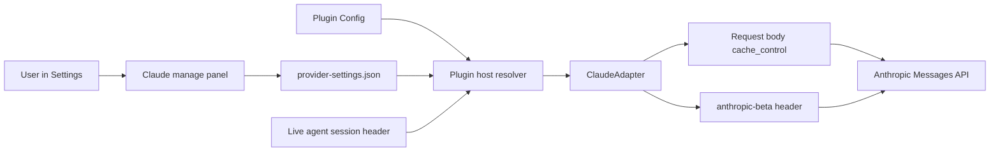
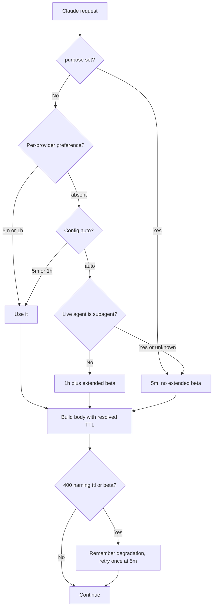
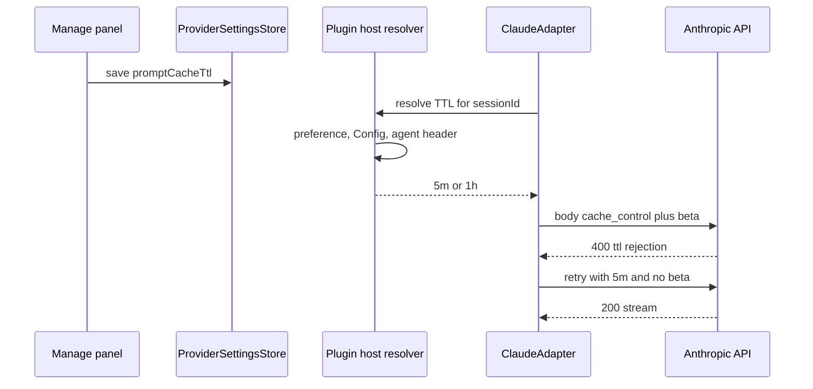

# Claude prompt cache lifetime policy

> The Claude route uses a cache TTL that matches Claude Code: one hour for main conversations, five minutes for subagents and auxiliary requests, with the beta value the OAuth endpoint expects.

## 1. Feature Snapshot

| Field | Details |
|---|---|
| Document status | Active |
| Implementation status | Shipped, live wire check pending |
| Owner | Parth Patel |
| Primary actors | DSH user on a Claude subscription; the Claude adapter on every model request |
| Trigger | Any Claude model request; the Settings, Models, Claude manage panel for the override |
| Outcome | A 5 to 6 minute idle wait no longer turns the next turn into a full-price prompt rewrite |
| Entry points | `settings.models.provider-card` manage panel, plugin Config, `ctx.llm` adapter dispatch |
| Data stores | Plugin Config, `~/.dsh/plugins/subscriptions/provider-settings.json` |
| Feature flag | `claudePromptCacheTtl` Config value; `promptCacheTtl` per-provider preference |
| Last verified | `pnpm build` and `pnpm test` (756 pass) on the uncommitted working tree, 2026-11-12. No commit exists, so claims below are labeled Inferred. Live wire check pending AC-010. |

**Status legend.** Every `Status` value below is one of: **Current** (read in the code at `last_verified_commit`) · **Planned** (not implemented) · **Inferred** (not directly verified) · **Unknown**.

## 2. Problem and Outcome

**Problem.** The Claude route defaults every request to Anthropic's five-minute cache TTL. A subagent wait of 5 to 6 minutes outlives the cache, so the next turn reports a 0% cache hit and rewrites the whole prompt at the 1.25x cache-write rate. In the decoded local sessions this happened 16 times across 1,146 Claude turns and rewrote 3.70M tokens. The plugin already has a one-hour option, but it is not the default and the OAuth request path never sends the `extended-cache-ttl-2025-04-11` beta value that Claude Code sends.

**Desired outcome.** Main Claude conversations keep their cache through gaps of up to an hour. Subagents and auxiliary requests keep the cheaper five-minute cache. The one-hour option works on the OAuth endpoint, and if the endpoint rejects the beta or the TTL the request degrades to today's five-minute behavior instead of failing.

**How success is measured.** On the next Claude session, a turn after a gap over five minutes reports `cacheReadTokens > 0` instead of 0, and `usage.cache_creation.ephemeral_1h_input_tokens` is non-zero for one-hour writes. Both are visible in the session log and the chat cache-hit display.

## 3. Scope

**Included**

- A new `auto` value for the `claudePromptCacheTtl` Config field, made the default.
- Per-request TTL resolution: explicit preference, then Config, then session bucket.
- Session bucket detection for live agents: top-level is one hour, subagent is five minutes.
- The conditional `extended-cache-ttl-2025-04-11` beta value on one-hour requests.
- A one-time degradation to five minutes when the endpoint rejects the TTL or the beta.
- A cache lifetime control in the Claude manage panel and its RPC type.
- Unit tests and the feature document update.

**Excluded**

- Any keep-warm replay loop. That remains a separate future feature.
- TTL changes for Codex, Grok, Copilot or Antigravity. Their providers are out of scope.
- Detecting whether the Claude subscription is drawing usage credits. The user can set five minutes explicitly.
- Changes to compaction or session-title request behavior.

**Assumptions**

| ID | Assumption | Confidence | How it gets validated |
|---|---|---|---|
| ASM-001 | The OAuth Messages endpoint accepts `extended-cache-ttl-2025-04-11` in `anthropic-beta`; Claude Code 2.1.319 sends it | Medium | Live request after the usage limit resets |
| ASM-002 | The endpoint honors `cache_control.ttl: "1h"` on the OAuth path | Medium | Live request; check `ephemeral_1h_input_tokens` |
| ASM-003 | A live agent's session header carries `origin` and `delegationDepth`, and `ctx.get('agents')` exposes it | High | The existing `selectedSpeed` lookup in `src/index.ts` uses the same registry |
| ASM-004 | A rejected beta or TTL returns HTTP 400 whose message names the field | High | Unit test with a fake 400 body; real behavior after reset |

## 6. User Journey

1. The user opens Settings, Models, then Claude, Manage.
2. The panel shows a cache lifetime control with the Config default, five minutes, and one hour.
3. The user leaves it on the default (Auto) or picks a value and saves.
4. On the next Claude turn, the adapter resolves the TTL per request and sends the matching cache marks and beta header.
5. The next turn after an idle gap reports a cache read instead of a full rewrite.

**Alternate paths**

| Journey | Trigger | Expected outcome |
|---|---|---|
| Subagent turn | Delegated agent sends a request | Five minutes, no extended beta, unchanged cost |
| Compaction or title | Auxiliary request with a `purpose` | Five minutes, no extended beta |
| Endpoint rejects TTL | HTTP 400 naming ttl or the beta | One retry at five minutes, warning logged once, session continues |
| User overrides | Per-provider preference set | That value wins over the Config value |

## 7. System Context

The feature sits between the DSH agent loop and the Anthropic Messages API. The plugin's Claude adapter owns both the request body and the OAuth headers, so no harness change is needed.



## 8. Control Flow



| Step | Status | Controlling component | Failure behavior |
|---|---|---|---|
| Preference read | Inferred | `ProviderSettingsStore.promptCacheTtl` | Absent follows Config |
| Config validation | Inferred | `Config` schema and `apply` | Startup error for an unknown value |
| Session bucket | Inferred | Plugin host callback using `ctx.get('agents')` | Unknown session resolves to 5m |
| Body assembly | Inferred | `claudeRequestBody` | No failure path |
| Beta header | Inferred | `ClaudeAdapter.request` | Only added for an effective 1h TTL |
| Rejection fallback | Inferred | `ClaudeAdapter.streamCore` | One retry at 5m; second failure surfaces |

## 9. Data Flow

The only durable data is the Config value and the per-provider preference. Neither contains secrets. Tokens are read exactly as today and never logged.



**Sensitive data.** OAuth access tokens stay inside the adapter as today. The feature adds no logging of prompts, tokens, or account identifiers. The degradation warning carries only the API error text.

## 11. Implementation Map

### Implemented (uncommitted working tree)

| Layer | Responsibility | Repository path | Main symbol |
|---|---|---|---|
| Config | Accept `auto`, `5m`, `1h`; default `auto`; parse in `apply` | [src/index.ts](../../src/index.ts) | `Config`, `claudeCacheTtlFor` |
| Resolution helper | Map setting plus bucket to a concrete TTL; classify the session header; parse the Config value | [src/provider-settings.ts](../../src/provider-settings.ts) | `resolveClaudePromptCacheTtl`, `isClaudeSubagentSession`, `readClaudePromptCacheTtl` |
| Adapter TTL | Per-request TTL, conditional beta, rejection degradation | [src/providers/claude.ts](../../src/providers/claude.ts) | `requestCacheTtl`, `oneHourRejection` |
| Extended beta | One-hour beta value | [src/providers/claude.ts](../../src/providers/claude.ts) | `EXTENDED_CACHE_TTL_BETA` |
| Host wiring | Resolve the TTL from the live agent header | [src/index.ts](../../src/index.ts) | `claudeCacheTtlFor` |
| RPC | Config default for the panel label | [src/index.ts](../../src/index.ts) | `providerSettings` response |
| Client types | `promptCacheTtlDefault` | [src/client/rpc.ts](../../src/client/rpc.ts) | `ProviderSettingsValue` |
| Client UI | Cache lifetime select | [src/client/ProviderCard.tsx](../../src/client/ProviderCard.tsx) | `ManagePanel` |
| Copy | Labels and explainer, English and Chinese | [src/client/locales.ts](../../src/client/locales.ts) | `en`, `zh` |
| Tests | Bucket resolution, beta, rejection fallback, Config parsing and default | [test/claude-cache-ttl.spec.ts](../../test/claude-cache-ttl.spec.ts), [test/models.spec.ts](../../test/models.spec.ts) | AC- and CASE-named cases |
| Feature index | FEAT-004 row | [docs/features/README.md](README.md) | table |

### Generated or restricted

| Path or area | Classification | Rule |
|---|---|---|
| `lib/`, `lib-test/` | Generated | Rebuild with `pnpm build` and `pnpm test` |
| `~/.dsh/profiles/web/node_modules/dsh-plugin-subscription-usage` | Deployed copy | Reinstall the plugin into the profile after the build; a build alone does not update it |

## 14. Business Rules

| Rule ID | Status | Rule | Enforcement point | Test reference |
|---|---|---|---|---|
| BR-001 | Inferred | Config accepts `auto`, `5m`, `1h`; default is `auto` | `Config` schema, `apply` | AC-007 |
| BR-002 | Inferred | `auto` resolves to `1h` only for a top-level live session; subagent and unknown sessions get `5m` | host resolver plus `isClaudeSubagentSession` | AC-001, AC-002, CASE-001 |
| BR-003 | Inferred | A per-provider `promptCacheTtl` of `5m` or `1h` wins over Config; absent follows Config | host resolver | AC-005 |
| BR-004 | Inferred | Any request with `purpose` set uses `5m` and never the extended beta, regardless of Config | adapter request path | AC-003 |
| BR-005 | Inferred | `extended-cache-ttl-2025-04-11` is added to `anthropic-beta` only when the effective TTL is `1h` | `ClaudeAdapter.request` | AC-001, AC-002 |
| BR-006 | Inferred | A `5m` request is byte-identical to the current release, including the beta header | `ClaudeAdapter.request` | AC-004 |
| BR-007 | Inferred | A 400 whose message names ttl, cache_control or extended-cache-ttl triggers one retry at `5m` with no extended beta; the rejection is remembered for the adapter lifetime and warned once | `streamCore` | AC-006 |
| BR-008 | Inferred | Settings changes apply on the next request without a restart | existing per-request override | AC-005 |
| BR-009 | Inferred | `origin === 'subagent'` or `delegationDepth > 0` means subagent; a missing live agent or session id means `5m` | `isClaudeSubagentSession` | AC-002, CASE-001, CASE-006, CASE-007 |

## 15. Acceptance Criteria

### AC-001: Auto uses one hour for a main session

**Given** Config `claudePromptCacheTtl` is `auto` and a live top-level session
**When** the adapter sends a request without a `purpose`
**Then** every cache mark in the body carries `ttl: "1h"`
**And** the `anthropic-beta` header contains `extended-cache-ttl-2025-04-11`

### AC-002: Auto uses five minutes for a subagent session

**Given** Config is `auto` and the live agent has `origin === 'subagent'` or `delegationDepth > 0`
**When** the adapter sends a request
**Then** the cache marks omit `ttl`
**And** the beta header does not contain the extended value

### AC-003: Auxiliary requests stay at five minutes

**Given** Config is `1h`
**When** a request carries `purpose` for compaction or a session title
**Then** the marks omit `ttl` and the beta header omits the extended value

### AC-004: Explicit five minutes keeps today's bytes

**Given** Config or the preference is `5m`
**When** the adapter sends a request
**Then** body cache marks and the full beta header are identical to the current release

### AC-005: Preference overrides Config and applies without restart

**Given** Config is `5m` and the preference is `1h`
**When** the user saves and the next request runs
**Then** that request uses one hour; the reverse direction uses five minutes

### AC-006: A rejected TTL degrades instead of failing

**Given** a request with an effective one-hour TTL
**When** the endpoint returns 400, 403 or 422 naming ttl, cache_control, extended-cache-ttl, anthropic-beta or prompt cache
**Then** the adapter retries once with five minutes and no extended beta
**And** the retry result is returned
**And** one warning is logged
**And** later requests skip the one-hour attempt

### AC-007: Config validation

**Given** the Config schema
**When** `claudePromptCacheTtl` is omitted, `auto`, `5m`, `1h`, or an unknown value
**Then** the first four are accepted with `auto` as the default and the unknown value is rejected by `readClaudePromptCacheTtl`

### AC-008: The manage panel exposes the choice

**Given** the Claude manage panel
**When** it renders
**Then** it shows a cache lifetime select with the Config default, five minutes and one hour
**And** saving persists `promptCacheTtl` and the value survives reopening the panel

### AC-009: Build and tests pass

**Given** the final change
**When** `pnpm build` and `pnpm test` run
**Then** both pass

### AC-010: Live verification, deferred

**Given** the Claude account has usage again
**When** a main-session request runs with `auto` and the response usage is inspected
**Then** `usage.cache_creation.ephemeral_1h_input_tokens` is greater than zero
**And** after a 6 minute wait the next turn reports `cacheReadTokens > 0`

Status: Planned, blocked on the account usage limit. Not part of the offline build.

### Edge cases

| Case ID | Scenario | Expected behavior | Test type |
|---|---|---|---|
| CASE-001 | Session id present but no live agent | Five minutes | Unit |
| CASE-002 | Compaction request with Config `auto` | Five minutes, no extended beta | Unit |
| CASE-003 | 400 unrelated to the cache fields | Surface the error, no retry | Unit |
| CASE-004 | Retry at five minutes also fails | Surface the second error | Unit |
| CASE-005 | Config toggled 1h to 5m mid-session | Next request uses five minutes; one-time cache miss is acceptable | Manual |
| CASE-006 | Forked top-level session, `origin` absent | One hour (main bucket) | Unit |
| CASE-007 | Nested subagent, depth 2 | Five minutes | Unit |
| CASE-008 | Rate limited with 429 | Existing rate-limit behavior, no change | Unit |
| CASE-009 | Pool route serves a secondary account | TTL resolution is account independent; the account stays sticky as today | Inferred |

## 17. Security and Privacy

| ID | Requirement | Enforcement | Validation |
|---|---|---|---|
| SEC-001 | No OAuth token, prompt text, or account identifier enters logs | existing adapter logging | code review |
| SEC-002 | The degradation warning logs only the API error text | `onWarn` call site | unit test |
| SEC-003 | The new Config and preference fields are not secret | schema validation | unit test |
| SEC-004 | One-hour writes raise provider spend; the choice is explicit and reversible | Config, preference, fallback | AC-001, AC-005 |

## 20. Testing

| Test type | Required coverage | Path |
|---|---|---|
| Unit | Config schema and `apply` validation for `auto` | `test/models.spec.ts` |
| Unit | Resolution helper: preference, Config, subagent, unknown | `test/claude-cache-ttl.spec.ts` or a new spec |
| Unit | Body marks and beta header for 1h, 5m, `purpose` | `test/claude-cache-ttl.spec.ts` |
| Unit | 400 degradation retry and one-warning behavior | `test/claude-cache-ttl.spec.ts` |
| Unit | Provider settings validation round trip | `test/account-preferences.spec.ts` or equivalent |
| Live | One-hour write accounting and a 6 minute hit | deferred, AC-010 |

**Validation commands.**

```bash
pnpm build
pnpm test
```

Result on 2026-11-12: build passed, 756 tests passed (the serial run; one catalog-refresh test flakes under load on this machine and passes alone, serially, and on the rerun). The new spec covers the five-minute bytes, one-hour marks and beta, the header bucket for main, subagent, nested, fork and unknown sessions, session-aware override, auxiliary requests, the 400 and 422 rejection retries and the one-warning behavior.

The build alone does not update the copy the Web GUI loads. Reinstall the plugin into the profile and reload the page after the build.

## 24. Remaining rollout

The offline implementation is complete. Two steps remain.

### Step 1: Install the built plugin

- **Changes:** reinstall this package into `~/.dsh/profiles/web/node_modules/dsh-plugin-subscription-usage`; a `pnpm build` alone does not update the running GUI.
- **Validation:** open Settings, Models, Claude, Manage and confirm the cache lifetime control appears.
- **Done when:** the panel shows the control and a saved choice survives a page reload.

### Step 2: Live wire verification after the usage limit resets

- **Changes:** none. Inspect the response usage and the next session's cache hit.
- **Validation:** a small direct request (or a temporary debug log) must show `usage.cache_creation.ephemeral_1h_input_tokens > 0`; the session log only carries the total `cacheWriteTokens`. After a 6 minute wait, the next turn must report `cacheReadTokens > 0`. If the host log shows the one-hour rejection warning, the fallback is active and the beta value or the TTL needs adjustment.
- **Done when:** AC-010 is closed and the fallback warning was not needed, or the beta path is fixed.

## 26. Risks and Limitations

| Risk ID | Risk | Impact | Mitigation |
|---|---|---|---|
| RISK-001 | The OAuth endpoint rejects the beta or the one-hour TTL | Main Claude turns could fail | One retry at five minutes without the beta; warning; remembered degradation |
| RISK-002 | One-hour writes raise cost for short sessions | Higher spend for users who never idle | Preference and Config can force five minutes |
| RISK-003 | Claude Code drops to five minutes when drawing usage credits; the plugin cannot detect that | Extra cost while on paid credits | Document it; user sets five minutes explicitly |
| RISK-004 | The live agent lookup misses a main session | That request pays five minutes instead of one hour | Conservative default; the normal loop keeps the agent live |
| RISK-005 | Changing the TTL changes the beta set and the marks | One-time cache miss after a config change | Accepted; documented |
| RISK-006 | Live verification is blocked by the exhausted usage limit | AC-010 cannot be closed now | Offline tests and the fallback cover the build; verify when usage returns |
| RISK-007 | The static beta list comes from Claude Code 2.1.283 while the local CLI is 2.1.319 | The extended value could be dropped or changed | Value verified against the 2.1.319 binary; fallback covers rejection |
| RISK-008 | The deployed profile copy is not updated by `pnpm build` | The GUI keeps the old plugin | Reinstall into the profile after the build |

## 30. Changelog

| Date | Version | Change | Status | PR or author |
|---|---|---|---|---|
| 2026-11-12 | 0.1.0 | Plan created | Planned | Parth Patel |
| 2026-11-12 | 0.2.0 | Auto TTL, extended beta, rejection fallback, panel control, tests | Inferred | Parth Patel |
| 2026-11-12 | 0.2.1 | Unknown sessions stay at five minutes; 400/403/422 rejections degrade; host bucket tests | Inferred | Parth Patel |
